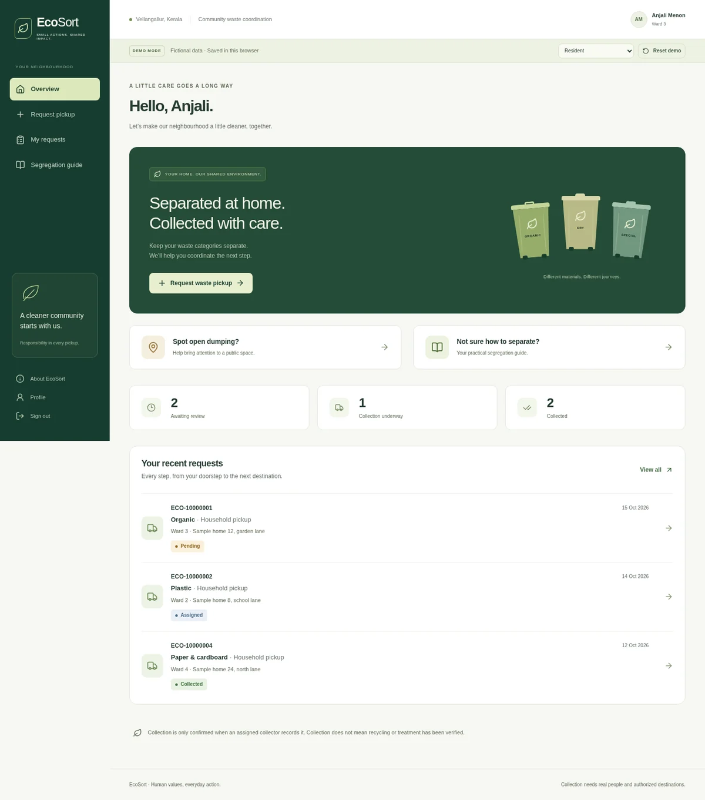
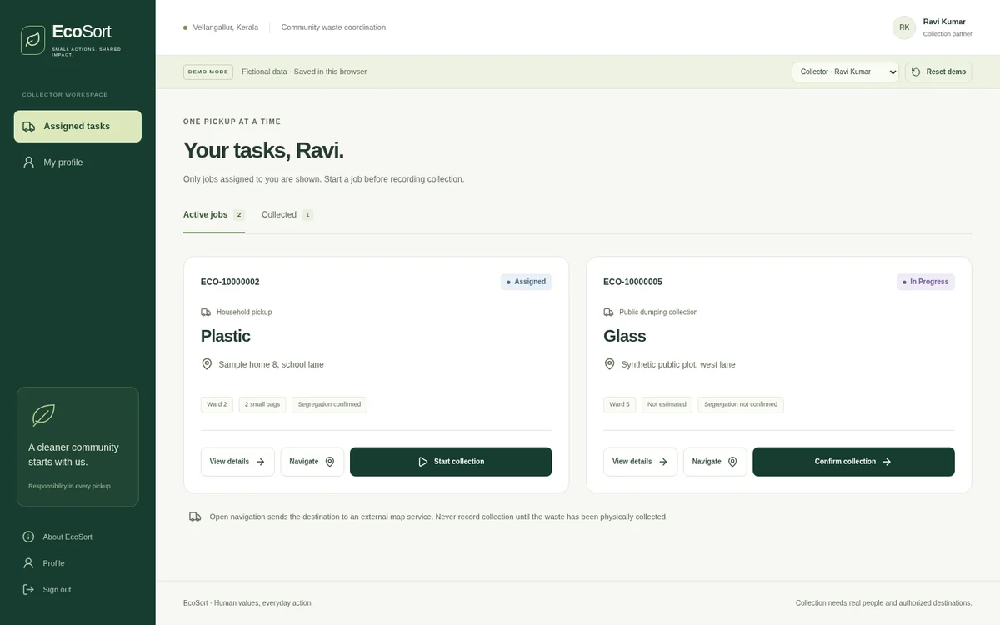
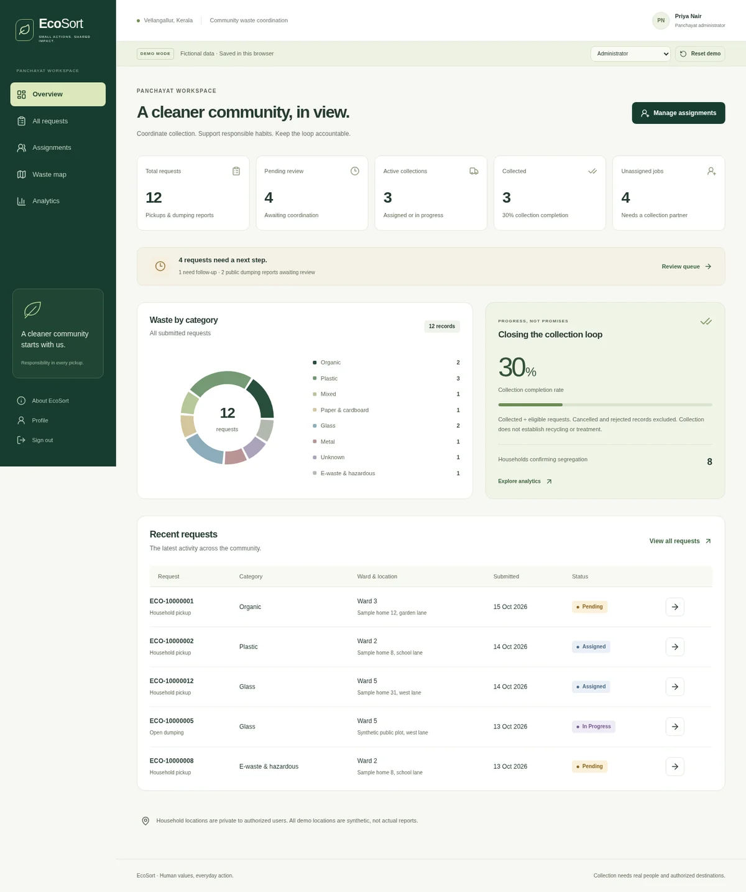
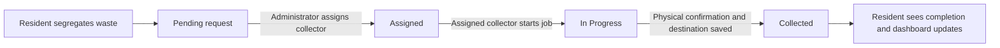

# EcoSort

**Smarter segregation. Coordinated collection. Cleaner communities.**

A responsive UHV college application for the assigned **Waste Management — Group 2** scenario in Vellangallur. The scenario is not an independently verified claim about current municipal services. This is not a complaint-only app, an actual collection service, or a municipal partnership.

EcoSort proposes a shared workflow for **Residents**, **Collectors** and **Panchayat Administrators**: teach household separation, request a pickup, coordinate a worker, and record collection and its destination. A separate form reports existing open dumping. Unlike a basic reporting app, the primary journey continues beyond submission to a recorded collection outcome.

**New teammate? Start with [START_HERE](docs/START_HERE.md).** For a quick demonstration, use the [presentation script](DEMO_SCRIPT.md).

## Screenshots

Actual desktop screens from the local demo; all names, locations and statistics shown are fictional. Images are optimized copies of the final QA captures, not mockups.

| Resident                                                                                        | Collector                                                                                | Panchayat Administrator                                                                             |
| ----------------------------------------------------------------------------------------------- | ---------------------------------------------------------------------------------------- | --------------------------------------------------------------------------------------------------- |
|  |  |  |

Open an image for the full-size view. [Feature guide](docs/FEATURE_GUIDE.md) explains each workspace.

## Run locally

Requires Node.js **22.12+** (verified with Node 24) and npm. Dependencies are locked in `package-lock.json`; install scripts are intentionally disabled in `.npmrc`.

Clone the repository, then open its project folder (SSH access to GitHub is required for this URL):

```bash
git clone git@github.com:milan-kb/EcoSort.git
cd EcoSort
```

Alternatively use GitHub's HTTPS clone URL, `https://github.com/milan-kb/EcoSort.git`, with access appropriate to the repository's visibility. If given a ZIP, extract it and open the folder containing `package.json`. [Cross-platform setup](docs/START_HERE.md) includes both paths.

```bash
npm ci
npm run dev
```

Open **http://localhost:5173**. No environment file, account, payment or Supabase credential is needed for demo mode. If Vite chooses another port because 5173 is occupied, use its printed URL; browser tests require 5173.

```bash
npm run build
npm run preview
```

The production preview normally runs at **http://localhost:4173**. Keep the local server running for the classroom presentation. After installation, demo mode and its coordinate map work without internet; online street tiles and external navigation naturally do not. This is a locally served application, not an installable/offline-cached PWA.

## Demo mode

Enter through the landing page or **Sign in**. Choose **Resident**, **Collector · Ravi Kumar**, **Collector · Fathima Ali**, or **Panchayat Administrator**. The visible **Demo role** selector changes the account and opens its workspace.

- All people, addresses, quantities, collection records and seed pins are **fictional**.
- One localStorage repository backs all roles; these are not disconnected mock screens.
- Requests, assignment changes, collections, status histories, profile edits and optional image data persist across refreshes in the **same browser and origin**.
- **Reset demo** asks for confirmation and restores the seed. It does not erase unrelated browser storage.
- Demo access rules are checked in the repository for workflow consistency. LocalStorage is editable and is **not a production security boundary**. Do not store real personal information in demo mode.
- One sequential store is intended for the presentation. Concurrent tabs use last-writer-wins; use Supabase for real multi-user operations.
- Photos are limited to JPEG/PNG/WebP, 2 MB each. Browser quotas limit the total; storage failures are shown without silently overwriting the previous record.
- Maps start offline, showing a labeled coordinate grid, not fabricated streets. Enable **Online map tiles** for OpenStreetMap. New demo coordinates are still demo inputs, not verified real reports.

See **[DEMO_SCRIPT.md](DEMO_SCRIPT.md)** for the 3–5 minute walkthrough.

## Application workflow



Residents can cancel their own **Pending** request with a reason. Administrators can reject **Pending**, **Assigned** or **In Progress** requests. The shared repository/SQL contract also permits administrator cancellation before work starts, though the current administrator UI exposes rejection. Collected, Cancelled and Rejected are terminal: no reopening or post-completion editing UI exists. Assignment can change only before work starts. [Lifecycle details](docs/DATABASE.md#status-and-integrity-rules).

## Implemented interfaces

| Role          | Working features                                                                                                                                                                                                                                                                     |
| ------------- | ------------------------------------------------------------------------------------------------------------------------------------------------------------------------------------------------------------------------------------------------------------------------------------ |
| Resident      | Profile, pickup submission with explicit segregation, separate dumping report, optional image, optional GPS/manual coordinates/map selection, manual segregation guide, request filters, status timeline, collector and collection confirmation, reasoned cancellation while pending |
| Collector     | Only assigned/completed jobs, simple active/collected tabs, external navigation, start job, explicit physical collection confirmation, optional proof, notes, intended destination vs actual handover                                                                                |
| Administrator | Stored-record dashboard, category and ward charts, 14-day activity, consistent completion rate, filters/search/pagination, assignment/reassignment before work starts, evidence/destination review, reasoned rejection, private operational map                                      |
| Shared        | Public landing/auth screens, About/UHV explanation, profile editing, protected role routes, 404, loading/error/empty/success states, accessible native confirmation dialogs                                                                                                          |

Public registration offers **resident only**. There is no OTP, fake AI, SMS, guaranteed appointment, treatment verification or automatic facility integration. The segregation assistant is manual and educational; guidance lives in `src/data/guidance.ts` and must be approved locally before operational use. E-waste/hazardous collection requires an authorized destination type and real specialist arrangements.

## Technology stack

| Technology                              | Purpose                                                                 |
| --------------------------------------- | ----------------------------------------------------------------------- |
| React + TypeScript                      | Components and shared typed data contracts.                             |
| Vite                                    | Local development server and production bundling.                       |
| Tailwind CSS + project CSS              | Utility styling, responsive layout and design tokens.                   |
| React Router                            | Public and role-protected page navigation.                              |
| TanStack Query                          | Workspace loading, caching and refresh.                                 |
| React Hook Form + Zod                   | Form state and input validation.                                        |
| Supabase JS, Auth, PostgreSQL, Storage  | Optional connected identity, authorized persistence and private images. |
| Leaflet + React Leaflet + OpenStreetMap | Coordinate selection and optional online street tiles.                  |
| Recharts + Lucide                       | Derived charts and interface icons.                                     |
| Vitest + React Testing Library + jsdom  | Logic and component checks.                                             |
| Playwright + axe-core                   | Chromium workflows, responsive screenshots and accessibility checks.    |
| PGlite                                  | Embedded PostgreSQL execution of migration/security tests.              |
| ESLint + Prettier                       | Code checks and consistent formatting.                                  |

## Connected Supabase mode

### Setup

1. Create a Supabase project. Apply **all SQL files in `supabase/migrations/` in filename order** to a **fresh project** using the SQL editor, or apply them through your existing Supabase CLI migration workflow. Existing installations must apply `202610150002_close_authorization.sql` to fix missing-profile authorization and `202610150003_phone_digits.sql` for phone validation; do not rerun the initial schema migration. The phone constraint preserves existing rows and enforces valid digits on new/updated profiles.
2. Copy `.env.example` to `.env` and configure:

   ```dotenv
   VITE_APP_MODE=connected
   VITE_SUPABASE_URL=https://YOUR_PROJECT.supabase.co
   VITE_SUPABASE_ANON_KEY=YOUR_PUBLIC_ANON_OR_PUBLISHABLE_KEY
   ```

3. Configure Supabase Auth's Site URL and allowed email confirmation redirect URLs for your local/deployed origin. Email/password signup stores name, phone and ward; email confirmation follows your project's Auth settings. **No OTP login is implemented.** Enable suitable Auth rate limits and email delivery settings in Supabase.
4. Restart Vite. Public signup always creates a resident. Provision verified collector/administrator users through the trusted SQL editor following **`supabase/seed/README.md`**. Never put a service-role key in the browser, source tree or a `VITE_` variable.
5. Use separate signed-in browser contexts for cross-user testing. Connected data refreshes on focus and every **10 seconds**; local mutations refresh immediately. This is polling, not a claimed Realtime subscription.

Connected mode fails closed with a configuration error if credentials are missing. Demo switching is absent and does not provision privileged roles.

The initial migration also creates the private Storage bucket and policies; do not make the bucket public or add permissive policies to fix setup errors. See [Database](docs/DATABASE.md) for migration details and [Security](docs/SECURITY.md) for Auth, Storage and provisioning boundaries.

### Security and data model

- Normalized `profiles`, `waste_requests`, `assignments`, `collections`, `request_status_history`, with FKs, indexes and database constraints.
- Household pickups and dumping reports use a required `request_type` discriminator, different form contracts, and separate security-invoker database views (`household_pickups`, `dumping_reports`). Shared lifecycle infrastructure is not duplicated.
- All application tables use RLS. Residents read their own requests; collectors read active/completed assignments, not resident profile directories; administrators manage the operational workspace. Residents can see their assigned collector's profile.
- Authenticated clients have **SELECT only** on tables. Creation, assignment, start, completion, closure and profile editing use narrowly authorized RPCs. No client can directly edit roles, statuses, assignments, evidence or history.
- Assignment and completion lock the request row and update related records in a single database transaction. Completion cannot skip In Progress; terminal statuses cannot be reopened. Reassignment is locked once collection begins. Status history is generated by a trigger.
- The `workspace_snapshot` RPC uses **invoker security** and RLS, returning one consistent authorized JSON snapshot. It avoids PostgREST's default row limit silently corrupting dashboard counts. The client aggregates this snapshot; this is appropriate for a small pilot, not a huge municipality.
- Bucket **`waste-images` is private**, with a 2 MB server-side limit, MIME allowlist, owner-scoped upload paths, reference-scoped read policies, and five-minute signed display URLs. Client code additionally checks image signatures. No SVG uploads. Server-side full image decoding/malware scanning is not implemented.
- Failed database operations attempt cleanup of unreferenced uploads. An interrupted network request may leave an orphan; operational storage cleanup is still needed. Previously issued signed links can remain valid until their short expiry.
- Connected auth tokens are kept **in memory**, not localStorage. **Reloading or closing a tab requires signing in again.** A browser-only SPA cannot implement HttpOnly session cookies without a server; this project does not pretend otherwise.
- Uploaded content is rendered only as images, and user text through React escaping. Addresses never appear on a public map. External navigation explicitly shares a destination with Google Maps.

### Operational prerequisites and deployment

You must arrange collectors, safe transport, local acceptance rules, authorized destinations, access provisioning and actual physical handover. The app cannot create these resources.

`public/_headers` and `public/_redirects` provide security headers and SPA rewrites for compatible static hosts (e.g. Netlify/Cloudflare Pages). Other hosts need equivalent configuration: rewrite unknown application paths to `index.html`, HTTPS, CSP, no-sniff, frame restrictions, referrer and geolocation policies. Vite dev/preview set basic non-CSP headers; HSTS and CSP must be served by the production host. Custom Supabase domains require updating the CSP host allowlist. Inline **styles**, not inline scripts, are allowed for Leaflet/Recharts positioning.

Before collecting real personal data, establish consent/privacy notices, retention and backup deletion periods, an administrator-assisted export/erasure process, recovery procedures, and a trusted operator correction policy. This classroom project does not implement self-service account deletion or claim regulatory compliance. Do not deploy it as a public municipal service without that operational review and hosted security testing.

## Tests and verification

All package scripts are listed below. Run them from the project folder; a script is a named command in [package.json](package.json).

| Command                | Purpose                                                                   |
| ---------------------- | ------------------------------------------------------------------------- |
| `npm run dev`          | Start Vite (normally port 5173).                                          |
| `npm run build`        | Type-check and create `dist/`.                                            |
| `npm run preview`      | Serve an existing build (normally port 4173).                             |
| `npm run typecheck`    | Run TypeScript project checking.                                          |
| `npm run lint`         | Check with ESLint.                                                        |
| `npm run format`       | Format supported files; **writes changes**.                               |
| `npm run format:check` | Check formatting without changing files.                                  |
| `npm test`             | Run unit/component tests once.                                            |
| `npm run test:watch`   | Run Vitest in watch mode.                                                 |
| `npm run test:e2e`     | Run browser tests in demo mode.                                           |
| `npm run test:sql`     | Run embedded PostgreSQL security scenarios; no hosted credentials needed. |

`npm audit` is an npm built-in command, not a custom script. For the full local check:

```bash
npm run typecheck
npm run lint
npm run format:check
npm test
npm run test:sql
npm run test:e2e
npm run build
npm audit
```

Browser tests use `/usr/bin/chromium` if available; otherwise install Playwright Chromium with `npx playwright install chromium`. An alternative executable can be supplied through `CHROMIUM_PATH`. Tests start the Vite server automatically if needed. Run browser tests in default **demo mode**, not against a live production project.

- **Vitest + React Testing Library:** shared workflow, required validation, authorization, legal transitions, hazardous destination checks, local persistence, reset and corruption handling.
- **Playwright:** request → assignment → collector → confirmation → resident → updated totals, refresh/reset, dumping/photo/GPS denial, role protection, maps and navigation at 320/768/1024/1440px.
- **axe-core:** automated WCAG AA checks across public and role pages, plus keyboard focus checks. These complement, not replace, a full human accessibility audit.
- **Embedded PostgreSQL (PGlite):** executes all actual migrations in filename order, then tests real SQL constraints, grants, RLS and RPC transactions. Minimal Auth/Storage schema stand-ins do **not** validate hosted Supabase email, JWT issuance, Storage upload HTTP validation or signed-URL generation.

Actual run results and outstanding checks are recorded in **[TEST_RESULTS.md](TEST_RESULTS.md)**. No Supabase credentials were provided; hosted connected-mode end-to-end testing remains outstanding.

See **[FINAL_QA_REPORT.md](FINAL_QA_REPORT.md)** for the independent adversarial audit, fixes and release recommendation. Representative fictional screenshots are generated in `qa-artifacts/`; all-page screenshots are in Playwright's `test-results/`.

The later **[real-world testing report](REAL_WORLD_TEST_REPORT.md)** records Chromium/Firefox workflows, actual tile requests, offline recovery, bounded tab concurrency and production-preview measurements, with separate demo/connected/municipal verdicts. Hosted Supabase remains blocked without a test project.

## Architecture

```text
src/app/          Routing, shared session/query context, error boundary
src/components/  Shell, controls, request lists and account links
src/features/    Resident, collector, administrator, maps, guide, shared pages
src/services/    Repository implementations: localStorage / Supabase
src/types/       Domain types and repository interface
src/lib/         Zod validation, transitions, derived statistics, image validation
src/data/        Fictional demo seed and editable educational guidance
src/styles/      Responsive design tokens and component styles + Tailwind
supabase/        Ordered SQL migrations and secure account provisioning instructions
tests/           Vitest/RTL, Playwright/axe, embedded PostgreSQL security checks
docs/            Onboarding, system guides, team handoff and curated screenshots
```

React + TypeScript + Vite, Tailwind CSS, React Router, Lucide, TanStack Query, React Hook Form/Zod, Leaflet/OpenStreetMap, Recharts and Supabase. No Express server, Redux, Docker, paid service, custom classifier or unnecessary mobile app.

## Current limitations / future proposals

- **Hosted Supabase integration needs credentialed verification.** SQL tests are not a substitute for testing hosted Auth and Storage.
- In-memory connected login requires reauthentication after refresh. No password-recovery UI, OTP, SMS or push notifications.
- Dashboard data is an authorized full snapshot; large deployments need server aggregates and paginated data loading. UI lists are already filtered and paginated.
- Actual handover is collector-reported. There is no independent treatment verification, facility receipt workflow or post-completion correction interface.
- Browser storage quotas and last-writer-wins limit the demo. No PWA caching or offline synchronization in connected mode.
- No hotspot prediction or image AI is included. Add those only after real operational data and validation exist.
- Cross-device connected testing, physical-device GPS and physical Safari remain unverified. Headless Firefox 157 was exercised on Linux; WebKit launch was blocked by missing host libraries. The [real-world testing report](REAL_WORLD_TEST_REPORT.md) gives the exact environment and remaining gates.

## Documentation index

| Guide                                                                   | Read it for                                                 |
| ----------------------------------------------------------------------- | ----------------------------------------------------------- |
| [Start here](docs/START_HERE.md)                                        | First installation and role exploration.                    |
| [Project explanation](docs/PROJECT_EXPLANATION.md)                      | Faculty questions and a plain-language overview.            |
| [Feature guide](docs/FEATURE_GUIDE.md)                                  | Screens, validation and user workflows.                     |
| [Architecture](docs/ARCHITECTURE.md)                                    | Routes, state, services and data flow.                      |
| [Database](docs/DATABASE.md)                                            | Tables, relationships, migrations and constraints.          |
| [Security](docs/SECURITY.md)                                            | Auth, RLS, private images and the authorization regression. |
| [Testing](docs/TESTING.md)                                              | Commands, test boundaries and documentation verification.   |
| [Contributing](docs/CONTRIBUTING.md)                                    | Suggested branch, commit and review practices.              |
| [Troubleshooting](docs/TROUBLESHOOTING.md)                              | Setup and runtime problems.                                 |
| [Team handoff](docs/TEAM_HANDOFF.md)                                    | Completed work, remaining work and submission checklist.    |
| [Demo script](DEMO_SCRIPT.md) / [UHV explanation](UHV_EXPLANATION.md)   | Classroom walkthrough and human-values rationale.           |
| [Test results](TEST_RESULTS.md) / [Final QA report](FINAL_QA_REPORT.md) | Dated execution evidence and release limitations.           |

## Academic context

EcoSort originated as a **Universal Human Values** course project responding to the assigned Vellangallur waste-management scenario. Responsibility, cooperation, participation and harmony with nature inform the workflow; [UHV_EXPLANATION.md](UHV_EXPLANATION.md) covers the academic rationale without claiming real local service integration.

## Contributors and license

Git history records commit authors; a separate contributor list has not been curated. Demo personas are fictional users, not contributor credits. The team should add verified credits with each person's agreement.

**No license file has been added.** Public availability alone does not grant an open-source license. The owners should agree on licensing before external reuse or distribution; this handoff does not select a license.
