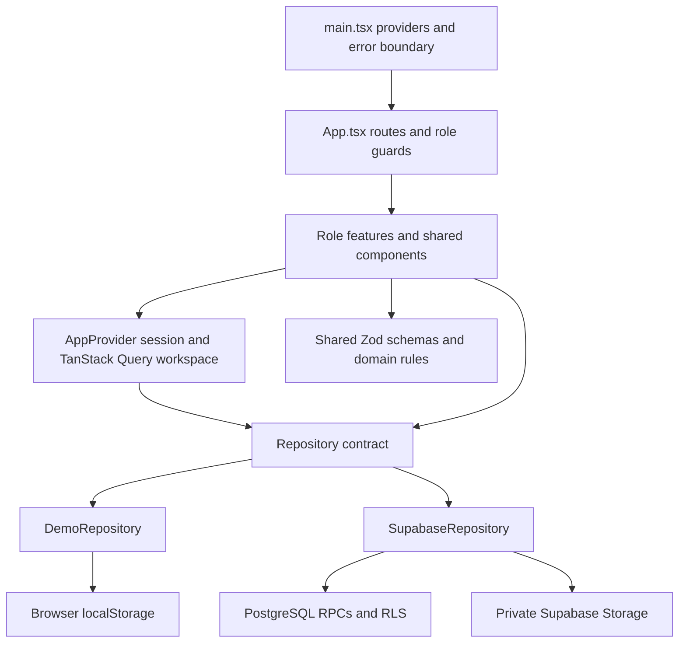

# Architecture: how EcoSort fits together

This guide follows the actual source structure and data flow. Start with [Start here](START_HERE.md) if you have not run the app; use [Database](DATABASE.md) and [Security](SECURITY.md) for backend details.

## High-level design

EcoSort is a **single-page application (SPA)**: one browser application renders different screens as the URL changes. There is no Express server, server-side rendering or separate custom API process. Vite serves local development files and builds static assets. The optional backend is Supabase.

The chosen adapter depends on `VITE_APP_MODE`; the app does **not** write to both stores. Demo is used unless the value is exactly `connected`. Missing connected configuration does not fall back silently to demo.

## Frontend structure

| Location                                          | Responsibility                                                                                       |
| ------------------------------------------------- | ---------------------------------------------------------------------------------------------------- |
| [src/main.tsx](../src/main.tsx)                   | React root, StrictMode, error boundary, QueryClient and BrowserRouter providers.                     |
| [src/app/App.tsx](../src/app/App.tsx)             | Route table, anonymous/role guards, route focus and scroll handling.                                 |
| [src/app/context.tsx](../src/app/context.tsx)     | Current actor (profile), demo switching/reset, connected Auth observer, workspace query and notices. |
| [src/components/](../src/components/)             | Shared layout, navigation, request lists/filters, confirmation dialogs and image controls.           |
| [src/features/](../src/features/)                 | Resident, collector, administrator, auth, maps, segregation and shared screens.                      |
| [src/types/domain.ts](../src/types/domain.ts)     | Types, category/status constants and `Repository` interface.                                         |
| [src/lib/](../src/lib/)                           | Validation, transitions, statistics, persisted-demo validation and image checks.                     |
| [src/data/](../src/data/)                         | Synthetic seed and manual educational advice.                                                        |
| [src/styles/global.css](../src/styles/global.css) | Design tokens and responsive component styling, with Tailwind imported.                              |

Administrator modules and maps are lazy-loaded (downloaded when needed) through React `lazy`/`Suspense`. Shared request details render the same stored record with role-appropriate actions.

## Routes

`:id` below is a full request UUID, not its shortened ECO display label.

| Access             | Routes                                                       | Screen                                                                             |
| ------------------ | ------------------------------------------------------------ | ---------------------------------------------------------------------------------- |
| Public             | `/`, `/signin`, `/signup`, `/about`                          | Landing, access/signup and project explanation. About also has a signed-in layout. |
| Resident           | `/resident`                                                  | Overview and own request counts.                                                   |
| Resident           | `/resident/pickup`, `/resident/dumping`, `/resident/guide`   | Separate request forms and segregation guide.                                      |
| Resident           | `/resident/requests`, `/resident/requests/:id`               | Own history, filters and details.                                                  |
| Collector          | `/collector`                                                 | Assigned active/completed tasks.                                                   |
| Collector          | `/collector/requests/:id`, `/collector/requests/:id/confirm` | Job details and collection/destination form.                                       |
| Administrator      | `/admin`, `/admin/requests`, `/admin/requests/:id`           | Operational dashboard and review.                                                  |
| Administrator      | `/admin/assignments`, `/admin/map`, `/admin/analytics`       | Assignment queue, private map and charts.                                          |
| Any signed-in role | `/profile`                                                   | Name, phone and ward editing; no role editing.                                     |
| Fallback           | Unmatched paths                                              | 404 page.                                                                          |

`Guard` redirects anonymous users to sign-in and renders an access-restricted screen for the wrong role. Record visibility comes from the repository/RLS too; hiding a route alone is not authorization.

## State and repository boundary

React state holds temporary form inputs, filters and modal feedback. **TanStack Query** caches a `Snapshot` of profiles, requests, assignments, collections and history for the current actor ID/role. `AppProvider` shares it through `useApp()`; there is no Redux store.

The `Repository` interface defines `load`, `create`, `assign`, `start`, `complete`, `close`, `updateProfile` and `imageUrl`. Screens call that contract instead of implementing persistence themselves. Shared Zod schemas validate form/repository inputs; PostgreSQL independently enforces connected permissions and integrity.

Query defaults: five-second stale time, one retry, refresh on window focus. Successful UI mutations invalidate workspace queries. Demo queries use `networkMode: 'always'` because localStorage reads do not need a connection; connected queries retain online network mode. Connected mode additionally polls every ten seconds; this is **not** a Realtime subscription. Demo storage events invalidate workspace queries when another tab changes the demo key, but do not make concurrent writes safe.

## Demo persistence

[DemoRepository](../src/services/demo.ts) stores one JSON snapshot under `ecosort-demo-v1`. The selected synthetic identity is stored separately under `ecosort-demo-actor`. The first missing snapshot is seeded by `createSeed()`; an existing invalid snapshot raises an error instead of being silently replaced. Reset is explicit and confirmed.

Each mutation reads, validates/checks permissions, changes related records in memory and saves the snapshot. Photo bytes become base64 data URLs inside it. Reads return an actor-scoped subset. These checks support the simulated workflow, not tamper-proof security: anyone controlling the browser can edit its storage. There is no cross-device demo synchronization, version migration or conflict resolution; writes are last-writer-wins.

## Connected persistence and authentication

[SupabaseRepository](../src/services/supabase.ts) maps operations to database RPCs (Remote Procedure Calls: named SQL functions exposed through Supabase). The Auth identity comes from the current session, **not** a caller-supplied actor ID. `workspace_snapshot()` returns one RLS-scoped JSON result. Images upload separately to private Storage; database failure triggers best-effort cleanup of an unreferenced upload. Storage and SQL are not one distributed transaction.

Email/password access is handled by Supabase Auth. Signup creates resident profiles through a database trigger; privileged roles need trusted provisioning. Tokens remain in memory, so reload requires signing in again. Background token refresh reloads profile information without deliberately unmounting the same user's form. Hosted Auth/Storage remains unverified; mocked component tests are not evidence of hosted success.

## Request data flow

1. `RequestForm` collects a pickup or dumping payload. React Hook Form tracks fields; Zod checks shape and conditional rules.
2. The selected repository creates a Pending request and its initial history. Optional photos are validated before storage.
3. The workspace query refreshes; shared request details show the ID/status/timeline.
4. An administrator selects a collector. Assignment replaces any active assignment before work starts.
5. The assigned collector starts the job, then submits explicit physical confirmation and a destination. Completion records one collection, completes the assignment and changes the request to Collected.
6. Refreshed data drives the resident view and administrator statistics. Connected users in other sessions see changes on focus/polling; demo role switching loads the same browser store.

## Statistics and map behavior

`statistics()` in [domain.ts](../src/lib/domain.ts) is the shared source for totals: total includes every request; pending/unassigned counts Pending; active counts Assigned plus In Progress; collected counts Collected. Rate is rounded `Collected / eligible × 100`, excluding Cancelled/Rejected from eligible, or zero when empty. `segregated`, labeled **Segregated pickup requests**, counts explicitly confirmed pickup requests, not distinct households.

[Analytics.tsx](../src/features/admin/Analytics.tsx) groups all submitted requests by category/ward, including closed ones. Fourteen-day activity counts submissions by UTC creation date, not completed pickups. Follow-up is a heuristic: unfinished records with a preferred date before today's UTC date, or without a date and older than seven days.

[WasteMap](../src/features/maps/WasteMap.tsx) uses Leaflet for both coordinate-grid and online tile views. Only valid coordinate pairs become markers; manually entered coordinates recenter the selection. GPS uses the browser's optional permission-based API. Google Maps navigation is an external link that shares the destination. No coordinates imply no map marker, not a fabricated position.

## Design decisions and trade-offs

- **One contract, two adapters:** the same screens demonstrate and perform connected work; demo is not a parallel set of static mockups.
- **One request table, distinct types:** pickup and dumping keep separate validation/forms/views while sharing assignment and history infrastructure.
- **Server-authorized atomic mutations:** request-row locks and triggers keep connected state/history consistent; frontend checks only improve UX.
- **One authorized snapshot:** avoids silent PostgREST row truncation, but full downloads/client aggregates suit a small pilot, not municipality-scale datasets.
- **Memory-only connected tokens:** avoids localStorage tokens, at the cost of reauthentication after reload; no cookie-based server session is implemented.
- **Offline demo coordinates:** preserves classroom workflows without implying offline connected synchronization or cached PWA support.

These are explanations of the current implementation, not a newly adopted architecture. For known gaps and rollout gates, read the [final QA report](../FINAL_QA_REPORT.md).
