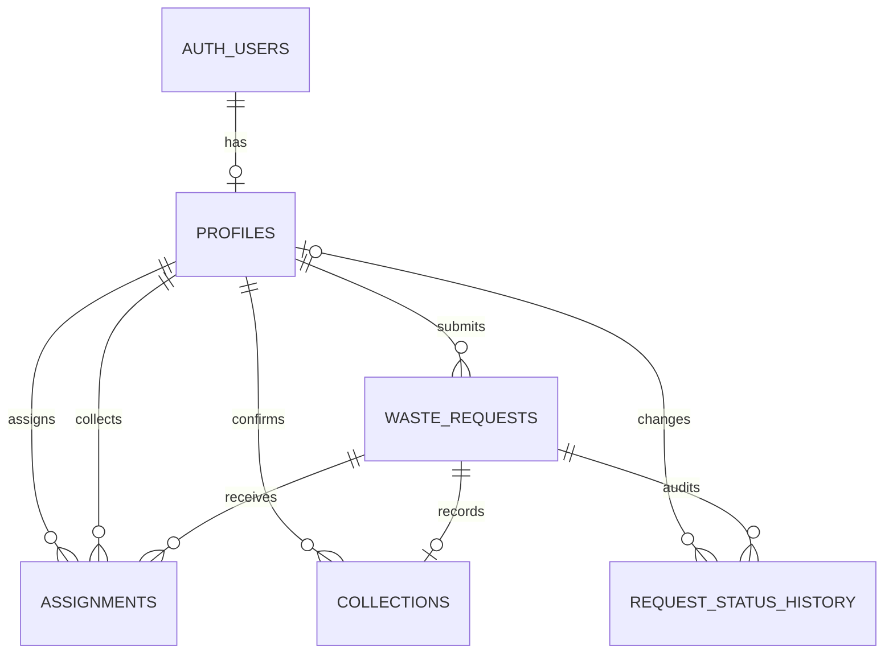

# Database: schema, migrations and connected setup

This guide documents the PostgreSQL schema actually shipped in [supabase/migrations/](../supabase/migrations/). You do **not** need a database for demo mode. Read [Security](SECURITY.md) before creating privileged accounts or handling real data.

## Model at a glance

A **primary key** uniquely identifies a row. A **foreign key** points to another row and prevents broken references. IDs here are UUIDs (unique identifiers), not the shortened ECO display labels. Timestamp fields use PostgreSQL `timestamptz`; the preferred date uses `date`.



`AUTH_USERS` represents Supabase's `auth.users`, not an application-created public table. A request can have several historical assignments but only one active assignment and at most one collection.

## Tables and important fields

All five public tables have an `id uuid` primary key, generated by default. Application tables contain no passwords; Supabase Auth owns authentication data.

| Table                    | Fields and relationships                                                                                                                                                                                                                                    |
| ------------------------ | ----------------------------------------------------------------------------------------------------------------------------------------------------------------------------------------------------------------------------------------------------------- |
| `profiles`               | `auth_user_id` (unique, required FK → `auth.users.id`, cascade on Auth user deletion), `name`, `phone`, `ward`, `role`, `created_at`. Signup trigger currently sets profile `id` equal to Auth user ID, although the FK contract is through `auth_user_id`. |
| `waste_requests`         | `resident_id` (FK → profiles), `request_type`, `waste_category`, `quantity`, `ward`, `address`, nullable `latitude`/`longitude`, `description`, nullable `image_path`, nullable `preferred_date`, `is_segregated`, `status`, `created_at`, `updated_at`.    |
| `assignments`            | `request_id` (FK → waste_requests, cascade on request deletion), `collector_id` and `assigned_by` (FKs → profiles), `assigned_at`, `status`. Partial unique index permits only one `active` assignment per request.                                         |
| `collections`            | Unique `request_id` (FK → waste_requests, cascade), `collector_id` (FK → profiles), `collected_at`, nullable `proof_image_path`, `notes`, `destination_type`, `destination_name`, `destination_status`.                                                     |
| `request_status_history` | `request_id` (FK → waste_requests, cascade), nullable `previous_status`, `new_status`, nullable `changed_by` (FK → profiles), `changed_at`, nullable `reason`. Generated by a trigger, not a client-supplied audit log.                                     |

Other profile references do not cascade. Deleting an Auth user with referenced operational records may therefore fail; account deletion/erasure is not a finished app workflow. Do not manually remove records to bypass FK errors.

### Allowed values

- `role`: `resident`, `collector`, `admin`.
- `request_type`: `pickup`, `dumping`.
- `waste_category`: `Organic`, `Plastic`, `Paper & cardboard`, `Glass`, `Metal`, `E-waste & hazardous`, `Mixed`, `Unknown`.
- Request/history status: `Pending`, `Assigned`, `In Progress`, `Collected`, `Cancelled`, `Rejected`.
- Assignment status: `active`, `completed`, `replaced`, `cancelled` (different from request status).
- `destination_type`: `composting`, `sorting`, `authorized_hazardous`, `other`.
- `destination_status`: `intended`, `handed_over`. Neither is independent treatment verification.

## Status and integrity rules

| Current request status           | Allowed next statuses            |
| -------------------------------- | -------------------------------- |
| Pending                          | Assigned, Cancelled, Rejected    |
| Assigned                         | In Progress, Cancelled, Rejected |
| In Progress                      | Collected, Rejected              |
| Collected / Cancelled / Rejected | None                             |

Legal status is only one check: actor permissions and assignment must also match. Residents can cancel only their own Pending requests. Administrator closure supports Cancelled/Rejected where legal, but the current UI exposes rejection. The assigned collector alone starts/completes a job. Reassignment while Assigned leaves request status Assigned and preserves a replaced assignment; it does not create another status-change entry.

Database constraints and RPCs enforce:

- New requests start Pending; a trigger creates initial history and checks later status changes. Another trigger updates `updated_at`.
- Pickups require nonblank quantity, explicit segregation and a category other than Mixed/Unknown. Dumping requires at least 10 description characters.
- Coordinates are both absent or both present and in range (latitude −90..90, longitude −180..180).
- Name 2–80 trimmed characters; phone 7–20 digits/spaces/parentheses/hyphens with optional leading `+` and at least seven digits; ward 1–40 trimmed characters.
- Quantity ≤100, address 5–300 trimmed, description/notes ≤2,000, image paths ≤300 characters; destination name 3–200 trimmed. Closure requires a 5–500 character trimmed reason.
- Completion requires In Progress, an active assignment to the caller and explicit `confirmed=true`. The confirmation boolean is an RPC input, **not a stored collection column**.
- E-waste/hazardous completion requires `authorized_hazardous` destination type.
- Assignment/start/completion/closure lock the request row. Completion inserts destination/collection, completes the assignment, updates status and creates history atomically: failure rolls back the SQL operation.

Indexes support resident/date, status/ward, category/type, collector assignment, history/time and referenced profile lookups. See the migration for exact index definitions.

## Read views, snapshot and write functions

`household_pickups` and `dumping_reports` are security-invoker views of `waste_requests`, filtered by `request_type`; they do not duplicate records. `workspace_snapshot()` returns authorized arrays as `profiles`, `requests`, `assignments`, `collections`, `history`. The last key maps to `request_status_history`.

Authenticated browser clients have SELECT grants, not direct INSERT/UPDATE/DELETE on application tables. Writes go through authorized **RPCs** (database functions callable through Supabase):

| Function                                       | Operation                                                 |
| ---------------------------------------------- | --------------------------------------------------------- |
| `create_request(p_id, p_payload)`              | Resident creates own Pending request.                     |
| `assign_request(p_request, p_collector)`       | Administrator assigns/reassigns before collection starts. |
| `start_collection(p_request)`                  | Assigned collector starts work.                           |
| `complete_collection(p_request, p_payload)`    | Assigned collector confirms and records destination.      |
| `close_request(p_request, p_status, p_reason)` | Authorized reasoned cancellation/rejection.               |
| `update_my_profile(p_name, p_phone, p_ward)`   | Caller edits own contact fields, never role.              |

## RLS overview

**Row Level Security (RLS)** filters database rows by authenticated identity. Residents read their own requests; collectors read requests with their active/completed assignments; administrators read the operational workspace. Related assignments, collections and history use request visibility. Profile reads allow self, administrators, and residents' assigned/completed collector profiles. Collectors do not receive a resident profile directory.

Mutation functions use narrowly authorized security-definer execution (owner privileges) with a fixed search path; they must check identity explicitly. Snapshot/views use invoker security, retaining RLS. Read [Security](SECURITY.md) for the missing-profile bug and why the forward fix is mandatory.

## Migration and connected setup

Use a **fresh development Supabase project**, not a live municipal database. Hosted testing is still outstanding. No Docker or Supabase CLI configuration is supplied; the SQL editor is sufficient. If your team already uses a migration runner, follow its tracked history rather than guessing which files ran.

### 1. Apply SQL in this order

| Order | File                                                                                                | Effect                                                                                            |
| ----- | --------------------------------------------------------------------------------------------------- | ------------------------------------------------------------------------------------------------- |
| 1     | [202610150001_ecosort.sql](../supabase/migrations/202610150001_ecosort.sql)                         | Tables, indexes, triggers, functions, views, RLS/grants and private Storage bucket/policies.      |
| 2     | [202610150002_close_authorization.sql](../supabase/migrations/202610150002_close_authorization.sql) | Replaces closure authorization to reject missing profiles and non-true authorization expressions. |
| 3     | [202610150003_phone_digits.sql](../supabase/migrations/202610150003_phone_digits.sql)               | Adds the at-least-seven-digits phone constraint.                                                  |

Paste each complete file into the trusted Supabase SQL editor and execute in order. The initial schema is **not idempotent**: it creates objects once. Existing installations apply only unapplied migrations; never rerun the initial file or drop tables just to clear an “already exists” message. Record what ran. The initial file alone is not the current secure schema.

The phone constraint is `NOT VALID`: PostgreSQL enforces it on new/updated rows without scanning or deleting pre-existing profiles. Existing invalid phones require correction before formally validating that constraint; do not imply old data was cleaned automatically.

### 2. Configure Auth and public browser settings

Enable email/password signup in Supabase Auth. Configure Site URL and allowed redirect URLs for the origin you actually use, for example `http://localhost:5173`. Email confirmation follows the project's Auth setting. Configure email delivery/rate limits before external users. The signup trigger needs valid `name`, `phone`, `ward` metadata; the app supplies it. Dashboard-created/invited users need valid metadata too.

Copy [.env.example](../.env.example) to `.env` (see cross-platform instructions in [Troubleshooting](TROUBLESHOOTING.md#environment-and-connected-errors)) and set:

```dotenv
VITE_APP_MODE=connected
VITE_SUPABASE_URL=https://YOUR_PROJECT.supabase.co
VITE_SUPABASE_ANON_KEY=YOUR_PUBLIC_ANON_OR_PUBLISHABLE_KEY
```

These are placeholders, not credentials. Use only a browser-safe public key; **never a service-role/secret key**. Restart Vite after edits, rebuild for production configuration changes. Missing configuration does not authorize demo entry into a connected project.

### 3. Check Storage and provision roles

The migration creates **private** `waste-images`, 2,097,152-byte limit, JPEG/PNG/WebP MIME allowlist and Storage policies. Do not recreate it as public. Uploaded paths are `auth-user-uuid/request-uuid/file-uuid.ext`; SQL validates attachment ownership/existence. Images display through five-minute signed URLs. No SQL seed inserts sample users/jobs into connected mode.

Create a resident through the app, confirm email if required, then follow [trusted provisioning instructions](../supabase/seed/README.md) for a separately verified collector/administrator. Never grant role selection to public signup. Sign out/in after provisioning. Resolve active jobs before role demotion/deletion.

### 4. Verify before real use

Use separate signed-in browser contexts for resident, collector and administrator. Exercise signup/sign-in, cross-user assignment, rejection of unauthorized operations, private uploads, signed image reads and collection/destination persistence. Other users refresh on focus or ten-second polling. Reload requires signing in again because tokens are memory-only. Embedded SQL tests cannot substitute for these hosted checks; [Testing](TESTING.md) defines the boundary.
